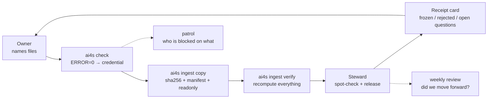

# AI4S Governance

Every lab has an afternoon like this: someone asks "which file is the real one?", and the room goes quiet.

This repo is a small, forkable research data management kit for AI4S (AI for Science) teams that want a better answer. It gives you four-zone filenames, a registry whose approvals are tied to the content they approved, one library that only grows, and a ledger for claims that turned out to be wrong.

Agents do most of the running. The program decides pass or fail. People sign, spot-check, and release.

[中文说明](README.zh-CN.md) · [Playbook](docs/00-overview.md) · [Machine contract](spec/filename-schema.yaml) · [When this is a fit](#when-this-is-a-fit)

---

## The problem

Four failures tend to show up together in a small AI4S team:

1. **The filename only means something to the person who made it.** Conditions live in folder names, versions are called `final_v2`, and an agent has to open every file to guess.
2. **The registry says `APPROVED`, but nobody can prove it.** The approval was typed into a field, not recorded as an event. One agent fills it with a job title; another edits the entry after signing.
3. **Measured and computed data sit in the same folder.** A fit result and the raw trace look the same on disk. Six months later, nobody can tell which is which.
4. **A dead claim comes back.** You falsified it in March. In June it is in a slide deck again, because the old deck never got the memo.

The common thread: the facts are not in a form a machine can check.

## The one idea

Traditional governance assumes a patient person: reads the SOP, fills the metadata, remembers to unsign. Agents don't do any of that. They are fast, literal, confident, and will use whatever the tool leaves open — including "fixing" a warning by inventing a number.

So the rules here are not a document. They are checks at the tool boundary:

- the parser rejects a bad name;
- a signature stops verifying when the entry changes;
- a delivery gets no credential until the program says PASS;
- a claim stays dead because the ledger says so;
- signing, releasing, deleting, and messaging stay with a person.

That is what we mean by **agent-native**: not a tool for agents, but governance built for a lab where agents do the work.

This repo also keeps the repair log and the adoption curve; the final rules are only part of it: [13](docs/13-evolution.md) and [14](docs/14-adoption.md).

## What is inside

- **Four-zone filenames.** `identity__type__condition__time`, with a YAML file as the single source of truth.
- **A registry that can't quietly change.** Approvals are append-only signatures bound to a sha256 of the entry. Edit one character and the signature stops verifying.
- **One library that only grows.** Copy-only ingest, `manifest.tsv`, sha256 checks, read-only files, separate `data/` and `derived/` trees, provenance sidecars with four gates, and a void ledger that never deletes.
- **A weekly rhythm.** A four-folder workspace per person, a self-check that issues a credential, steward intake, patrol, receipt cards, and a Friday review that has to look at last week.
- **A place for dead claims.** Knowledge and model cards with confidence levels, plus a ledger (`claim / verdict / correction / caveats / residue / scope`) produced by adversarial review.
- **Two bots.** An adapter-agnostic core (`src/ai4s_governance/bot.py`) and a Feishu reference adapter. No dashboard by design.
- **Agent operations.** Task routing and a convergence loop: the strongest model is not the default for every edit, and acceptance tests decide when to stop ([15](docs/15-agent-ops.md)).
- **The repair log.** The architecture changed while people used it. Every change has a trigger, a cost, and something it did not fix ([13](docs/13-evolution.md)).
- **An adoption curve.** First PASS, first self-initiated check, first receipt; what sped it up and what slowed it down ([14](docs/14-adoption.md)).

## When this is a fit

Use it when:

- your agents can't find a file without opening it;
- nobody can prove who approved a code, or which version they approved;
- measured and computed results look the same on disk;
- a claim you killed two months ago is back in a slide deck.

Don't use it for:

- a data catalog, lineage, or PII platform — use DataHub, Collibra, or OpenMetadata;
- a RAG memory or vector store — that is a different layer;
- LIMS/ELN/workflow — integrate, don't replace;
- a turnkey product — this is a kit, and someone has to own the semantics.

The hard part isn't the parser. It's your registry (`BUF1`, `DK1`, `SOP`…) and your history of dead claims. A vendor can copy the grammar; it can't copy the ontology or the ledger.

## Quickstart

```bash
git clone https://github.com/rxdage/ai4s-governance.git
cd ai4s-governance
python -m venv .venv && . .venv/bin/activate    # Windows: .venv\Scripts\activate
pip install -e .

# build a fully self-consistent demo lab (registry, signatures, files, library)
python examples/build_demo.py

# the three commands that matter
ai4s registry verify --registry examples/demo/registry
ai4s check examples/demo/workspaces/owner-a/SR_DATA \
  --registry examples/demo/registry --library examples/demo/library
ai4s patrol --config examples/demo/lab.yaml

# run the test suite (stdlib unittest; no pytest required)
python -m unittest discover -s tests -v
```

Expected: `conclusion: OK`, `conclusion: PASS`, `[ok] Owner A`, and 38 passing tests.

## Run a data health check

Point it at a folder. It writes a report and changes nothing:

```bash
ai4s audit /path/to/lab-data --label "Lab A" --out audit_report.md
```

The report says how many filenames a machine can parse, the top syntax issues, duplicate names, and what to fix first. Add `--registry` to check approved codes, or `--json` for the raw numbers.

If the lab will not send files, send a names-only list (one relative path per line):

```bash
ai4s audit --names names.txt --label "Lab A" --out audit_report.md
```

Want a messy sample? `python examples/build_messy_lab.py --force` creates 115 files with the failure modes from the playbook; see [examples/messy-lab.md](examples/messy-lab.md).

## Measure adoption

`ai4s check` can append one JSONL row per run. `ai4s adoption` turns those rows, receipt replies and registry proposals into an M1–M5 report:

```bash
ai4s check <SR_DATA> --registry registry --library library \
  --log state/selfcheck_runs.jsonl --person owner-a
ai4s adoption --config lab.yaml --out state/adoption_report.md
```

## The filename, in one picture

```
R0007_W0012_D0003__MEAS__BUF1_DAQ1__T202603041430_RUN0000.csv
└──── zone 1 ─────┘ └ z2 ┘ └── zone 3 ───┘ └──── zone 4 ────┘└ ext ┘
   who (which object)  what    under what      when / which run
```

- Zones separated by `__`; parts inside a zone by `_`.
- All four zones required; body uppercase; extension lowercase.
- `R` = batch/campaign, `W` = sample/wafer, `D` = unit/die/replicate.
- `ALL` only in W/D; `R0000_ALL_ALL` = library-level file.
- Type codes are 2–15 uppercase letters; condition codes are `CLASS + digits`; `NA` stands alone.
- Max 200 bytes; unique inside the library; the library path is only `partition/Rxxxx/filename`.

Full rules and 12 anti-examples: [docs/01-naming.md](docs/01-naming.md).

## The loop



The key rule: **the program decides PASS, not the AI.** A credential is generated only when `ERROR = 0`; warnings are questions for the owner, not things an agent may "fix".

## Two editions, one core

| | Core | Reference edition |
|---|---|---|
| Purpose | fork and adapt | what we actually run |
| Registry | `spec/` + `registry/` | same |
| Bot | `bot.py` with `handle(sender, text)` | Feishu adapter, receipt cards, release/waive commands |
| Transport | none | Feishu/Lark webhook + reply |
| Storage | any filesystem | shared drive / NAS |

If your team uses Slack, Teams, Matrix or a local webhook, copy `adapters/feishu.py` and keep the `handle()` call. If you have no IM at all, the CLI works: `ai4s bot handle --sender ... "回执 ..."`.

## What it won't do

- It won't make your science right. PASS means "we didn't hit a known trap", not "this result is true".
- It won't run itself. Someone has to sign, spot-check, and release.
- It won't install and forget. You need to agree on types, conditions and objects, and keep a weekly rhythm. If nobody can own that, don't start.
- It isn't a catalog, a RAG memory, or a LIMS. It is the layer underneath them that keeps working when no service is running.
- It isn't a single source of truth. It records what was made, from what, and who signed off. It doesn't decide what's true.

## Evidence (desensitized)

- Vocabulary scan before designing the schema: **1,751,067 files**, 1,159,750 data-class, 17,909 raw instrument acquisitions.
- Registry: 39 type codes (7 derived).
- Library at one point: **1,592 data files + 135 sidecars**.
- Falsification ledger: **117** voided/corrected claims. One adversarial review: **12 drafts → 11 refuted** (27 agents, ~2.56M tokens, 343 tool calls).
- One "AI-organized" delivery still had **145 filename syntax errors, 192 unregistered codes, 1 unparseable YAML** — the origin of "AI self-assessment is unfalsifiable; the exit code is falsifiable".
- Seven self-overturns in two months; after a failure class was closed, **0 recurrences**.

Details: [docs/09-case-study.md](docs/09-case-study.md).

## Repository map

```
spec/            machine contract + registry templates + JSON Schemas
src/ai4s_governance/
  naming.py      four-zone parser (schema-driven, built-in selftest)
  registry.py    load / validate / sign / revoke (hash-bound signatures)
  selfcheck.py   pre-delivery gate, credential, pending questions
  audit.py       read-only lab data health check (parseable %, top issues, fix-first)
  adoption.py    M1-M5 adoption report from run logs, receipts and proposals
  ingest.py      copy-only ingest, manifest, verify, void ledger
  rename.py      guarded all-or-nothing rename with original-name log
  patrol.py      read-only "who is blocked on what"
  bot.py         adapter-agnostic receipt / release / waiver core
  ledger.py      deprecation ledger validation and query
  adapters/      Feishu reference adapter
templates/       proposal, revision order, change request, sidecar, model card, weekly review...
docs/            the playbook (Chinese; 00–12)
examples/        demo builder, messy-lab generator, ledger example, walkthrough
scripts/         desensitization scanner
```

## Documentation

The full playbook is in Chinese. Start with:

| Doc | What |
|---|---|
| [English overview](docs/en/overview.md) | one-page English entry |
| [Cheatsheet](docs/cheatsheet.md) | one printable page |
| [00 overview](docs/00-overview.md) | the four failures, five principles, four layers |
| [01 naming](docs/01-naming.md) | the complete four-zone spec |
| [02 registry](docs/02-registry.md) | three tables, hash-bound signatures, truth chain |
| [03 intake](docs/03-intake.md) | library, sidecars, four gates, change rules |
| [04 roles & AI](docs/04-roles-and-ai.md) | RACI, twelve red lines, what an agent may not do |
| [05 cadence](docs/05-cadence.md) | four-folder workspace, patrol, receipts, weekly review |
| [06 knowledge](docs/06-knowledge.md) | KB/model cards, L0–L3, A–D–X confidence |
| [07 falsification](docs/07-falsification.md) | adversarial review and the deprecation ledger |
| [08 adoption](docs/08-adoption.md) | 30/60/90-day rollout |
| [09 case study](docs/09-case-study.md) | numbers, failures, honest boundaries |
| [10 decisions](docs/10-decisions.md) | why this design, and rejected alternatives |
| [11 FAQ](docs/11-faq.md) | objections and practical answers |
| [12 publishing](docs/12-publishing.md) | desensitization checklist |
| [13 evolution](docs/13-evolution.md) | fifteen repairs, with triggers, costs and unresolved parts |
| [14 adoption](docs/14-adoption.md) | how five people started using it, and what we failed to measure |
| [15 agent ops](docs/15-agent-ops.md) | task routing, convergence loops, and the real cost of a change |
| [16 writing](docs/16-writing.md) | the humanizer checklist every human-facing text must pass |
| [Field notes](docs/field-notes/README.md) | four publishable essays: audit, evolution, adoption, agent ops |
| [GitHub listing](docs/github-listing.md) | About text, topics and pinned issue |
| [llms.txt](llms.txt) | compact map for AI search and agents |

English translations are welcome — open a PR that keeps the Chinese original and adds `*.en.md`.

## Status

`v0.1` — the contract, tools, demo and tests are complete and run locally. The Feishu adapter is a reference implementation: it handles text events and signatures, but encrypted callbacks need one more AES step; test it in a private tenant before production. The playbook is the primary artifact; the code is deliberately small enough to read in an afternoon.

## Contributing

See [CONTRIBUTING.md](CONTRIBUTING.md). The most useful contributions are:

- adapters for other transports (Slack/Teams/Matrix/local webhook);
- translations of the playbook;
- case studies from other AI4S domains;
- simplifications — rules that can be deleted without losing a guarantee.

## License

Code MIT; documentation CC BY 4.0. See [LICENSE](LICENSE) and [LICENSE-docs](LICENSE-docs).
