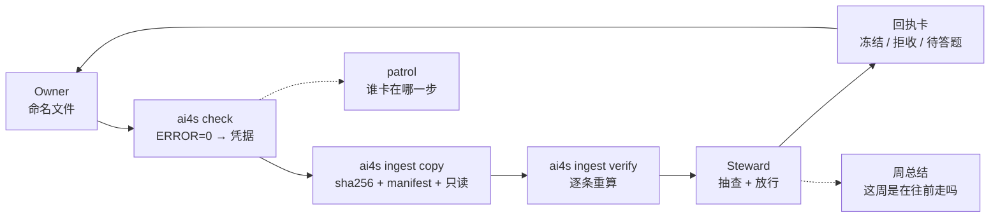

# AI4S Governance · 研发数据与结论治理

每个实验室都有这样一个下午：有人问“到底哪个文件才是真的？”，然后没人接得上话。

这个仓库就是为了让这个问题有答案。它是一套给 AI4S（AI for Science）团队用的小型研发数据管理 kit，可以 fork：四区命名、签名绑内容的注册表、一个只增不改的库、一本记录“哪些结论后来被推翻了”的台账。

agent 负责跑，程序负责判，人负责签字、抽查、放行。

[English README](README.md) · [方法论文档](docs/00-overview.md) · [机器契约](spec/filename-schema.yaml) · [什么时候适合用](#什么时候适合用)

---

## 问题

四件事通常是一起出现的：

1. **文件名只有做的人看得懂。** 条件在目录名里，版本叫 `final_v2`，agent 只能一个个打开猜。
2. **注册表写着 `APPROVED`，但没人证明得了。** 批准是打在字段里的字，不是一个事件。一个 agent 把它填成职位，另一个签完字又改了条目。
3. **测出来的和算出来的放在同一个夹里。** 拟合结果和原始曲线在磁盘上长得一样，半年后没人分得清。
4. **死掉的结论会回来。** 三月推翻了，六月又出现在 PPT 里，因为旧 PPT 没收到通知。

这些问题的共同点：事实没有一种机器能检查的形式。

## 核心想法

传统治理假设有一个耐心的人：读 SOP、填元数据、记得 unsign。agent 不会。它快、字面、自信，工具留什么口子它就钻什么——包括为了消掉一个 WARN 编一个数。

所以规则不写在文档里。它们落在工具边界上：

- 解析器不接受坏名字；
- 条目一改，签名自动失效；
- 程序不说 PASS，就不给凭据；
- 台账说它死了，它就翻不了身；
- 签字、放行、删除、发消息，永远归人。

它是给“agent 干活”的实验室做的治理，不是给 agent 做的工具。

这个仓库不只放最终规则，也放修理过程和五个人的 adoption 曲线：[13](docs/13-evolution.md) 与 [14](docs/14-adoption.md)。

## 什么时候适合用

适合：

- agent 不打开文件就找不到；
- 说不清谁批过哪个码、批的是哪一版；
- 测的和算的在磁盘上长得一样；
- 两个月前推翻的结论又回到 PPT 里。

不适合：

- 数据目录、血缘、PII 合规——用 DataHub、Collibra、OpenMetadata；
- RAG 记忆库、向量库——那是另一层；
- LIMS / ELN / 流程：集成，不替代；
- 即装即用的产品——这是 kit，得有人对语义负责。

解析器不难。难的是你的注册表（`BUF1`、`DK1`、`SOP` 这些码）和你的作废历史。厂商能抄文法，抄不了本体，也抄不了台账。

## 里面有什么

- **四区文件名。** `身份__类型__条件__时序`，YAML 契约是唯一真值。
- **一个不会悄悄变的注册表。** 批准是只追加的签名，绑在条目内容的 sha256 上；改一个字，签名就失效。
- **一个只增不改的库。** 复制入库、`manifest.tsv`、sha256 校验、只读、`data/` 与 `derived/` 分开、带四道闸门的 sidecar、只追加不删除的作废清单。
- **一套每周的节奏。** 每人四个夹子、自查出凭据、Steward 收库、巡检、回执卡、周五总结必须回看上一周。
- **一个放死结论的地方。** 知识卡/模型卡带置信分级；证伪台账记 `claim / verdict / correction / caveats / residue / scope`。
- **两个机器人。** 与平台无关的核心 + 飞书参考适配器。刻意不做看板。
- **Agent 运营。** 任务路由 + 收敛环：不是所有活都用最强模型，验收测试决定什么时候停（[15](docs/15-agent-ops.md)）。
- **一份修理记录。** 架构是边用边改的；每个改动都有触发、代价、和“没解决”的部分（[13](docs/13-evolution.md)）。
- **一条教化曲线。** 第一个 PASS、第一次自己发起自查、第一次回执；什么加速了、什么拖慢了（[14](docs/14-adoption.md)）。

## 快速开始

```bash
git clone https://github.com/rxdage/ai4s-governance.git
cd ai4s-governance
python -m venv .venv
# Linux/macOS: source .venv/bin/activate
# Windows:     .venv\Scripts\activate
pip install -e .

# 生成一个完全自洽的演示实验室（注册表、签名、文件、库）
python examples/build_demo.py

# 三条最重要的命令
ai4s registry verify --registry examples/demo/registry
ai4s check examples/demo/workspaces/owner-a/SR_DATA \
  --registry examples/demo/registry --library examples/demo/library
ai4s patrol --config examples/demo/lab.yaml

# 跑测试（标准库 unittest，不需要 pytest）
python -m unittest discover -s tests -v
```

期望输出：`conclusion: OK`、`conclusion: PASS`、`[ok] Owner A`，38 个测试全过。

> Windows 控制台若出现编码问题，先 `chcp 65001` 或设置 `PYTHONIOENCODING=utf-8`。

## 跑一次数据体检

指向一个目录，出一份报告，不改任何文件：

```bash
ai4s audit /path/to/lab-data --label "Lab A" --out audit_report.md
```

报告会说：多少文件名机器能解析、最常见的语法问题、重复的文件名、先修哪三个。加 `--registry` 可以顺便查码是否已注册，加 `--json` 拿原始数字。

如果对方不方便给文件，只给一份“名字清单”（一行一个相对路径，不含内容）：

```bash
ai4s audit --names names.txt --label "Lab A" --out audit_report.md
```

想要一个“乱样本”？`python examples/build_messy_lab.py --force` 生成 115 个文件，覆盖 playbook 里的各种失败模式；见 [examples/messy-lab.md](examples/messy-lab.md)。

## 量 adoption

`ai4s check` 可以每次追加一行日志。`ai4s adoption` 从日志、回执、提案里算出 M1–M5：

```bash
ai4s check <SR_DATA> --registry registry --library library \
  --log state/selfcheck_runs.jsonl --person owner-a
ai4s adoption --config lab.yaml --out state/adoption_report.md
```

## 文件名，一张图

```
R0007_W0012_D0003__MEAS__BUF1_DAQ1__T202603041430_RUN0000.csv
└──── 第 1 区 ─────┘ └第2区┘ └─第 3 区 ──┘ └──── 第 4 区 ────┘└扩展名┘
   谁（哪个物理对象）   什么      什么条件        何时 / 第几轮
```

- 区之间 `__`，区内 `_`；四区缺一不可；正文全大写，扩展名小写。
- `R` = 批次/campaign，`W` = 样品/片，`D` = 个体/芯片/重复单元。
- `ALL` 只在 W/D；`R0000_ALL_ALL` 是库级文件。
- 类型码 2–15 个纯大写字母；条件码 `CLASS+数字`；`NA` 独占第三区。
- 全名 ≤ 200 字节；库内唯一；库路径只有 `分区/Rxxxx/完整文件名`。

完整规则与 12 个反例：[docs/01-naming.md](docs/01-naming.md)。

## 闭环



最重要的一条：**PASS 由程序判定，不由 AI 判定。**
只有 `ERROR = 0` 才生成凭据；WARN 是给本人回答的问题，不是 AI 可以“改掉”的东西。

## 两个版本，一个核心

| | 核心 | 参考实现 |
|---|---|---|
| 目的 | 给别人 fork 和改 | 我们自己在跑的那套 |
| 注册表 | `spec/` + `registry/` | 同左 |
| 机器人 | `bot.py` 的 `handle(sender, text)` | 飞书适配器、回执卡、放行/豁免命令 |
| 传输 | 无 | 飞书/Lark webhook + 回复 |
| 存储 | 任意文件系统 | 共享盘 / NAS |

用 Slack/Teams/Matrix/本地 webhook 的团队，抄 `adapters/feishu.py`，保留 `handle()` 调用即可。
连 IM 都没有，就用 CLI：`ai4s bot handle --sender ... "回执 ..."`。

## 它不会做什么

- 不会让你的科学结论变对。PASS 只说明“没踩到已知的坑”，不说明“这个结果是真的”。
- 不会自己跑。总得有人签字、抽查、放行。
- 不是装上就能忘。你们得先对“对象、类型、条件”达成一致，再保持每周节奏；没人能承担这件事，就别开始。
- 不是数据目录、RAG 记忆库或 LIMS。它是它们下面那层，任何服务不跑的时候还在。
- 不是科学真值的唯一来源。它记录“谁用什么做出了什么、谁签过字”，不判定“什么是对的”。

## 规模证据（脱敏）

- 规范设计前的词汇扫描：**1,751,067 个文件**，1,159,750 个数据类，17,909 个仪器原始采集。
- 注册表：39 个类型码（7 个 derived）。
- 单源库某时点：**1,592 个数据文件 + 135 个 sidecar**。
- 证伪台账：**117 条**；一次对抗复核 **12 条初稿 → 11 条被推翻**
  （27 个 agent、约 256 万 token、343 次工具调用）。
- 一次“AI 整理过”的交付仍有 **145 个文件名语法错、192 个未注册码、1 份 YAML 解析失败**——
  这是“AI 自评不可证伪、程序退出码可证伪”的来源。
- 两个月自我推翻 7 次；某一类失败关闭后 **0 例复发**。

细节：[docs/09-case-study.md](docs/09-case-study.md)。

## 目录

```
spec/            机器契约 + 注册表模板 + JSON Schema
src/ai4s_governance/
  naming.py      四区解析器（schema 驱动，内置自测）
  registry.py    加载 / 校验 / 签字 / 撤销（哈希绑定）
  selfcheck.py   交付闸门、凭据、待确认清单
  audit.py       只读数据体检（可解析率、top 问题、先修什么）
  adoption.py    从运行日志、回执、提案算 M1–M5 adoption 报告
  ingest.py      复制入库、manifest、verify、作废清单
  rename.py      五道闸门、全有或全无的改名 + 原名日志
  patrol.py      只读巡检：谁卡在哪一步
  bot.py         与平台无关的回执/放行/豁免核心
  ledger.py      作废台账校验与查询
  adapters/      飞书参考适配器
templates/       提案、修订单、更改请求、sidecar、模型卡、周总结……
docs/            方法论（中文，00–12）
examples/        demo 构建、台账示例、反例 walkthrough
scripts/         脱敏扫描
```

## 文档

| 文档 | 内容 |
|---|---|
| [一页速查](docs/cheatsheet.md) | 打印版 |
| [00 总览](docs/00-overview.md) | 四个失败、五条原则、四层结构 |
| [01 命名](docs/01-naming.md) | 四区制完整规范 |
| [02 注册表](docs/02-registry.md) | 三张表、哈希签名、真值链 |
| [03 入库](docs/03-intake.md) | 单源库、sidecar、四道闸门、变更规则 |
| [04 角色与 AI](docs/04-roles-and-ai.md) | RACI、十二条红线、AI 不许做什么 |
| [05 节奏](docs/05-cadence.md) | 四夹制、巡检、回执、周总结 |
| [06 知识](docs/06-knowledge.md) | 知识卡/模型卡、L0–L3、A–D–X |
| [07 证伪](docs/07-falsification.md) | 对抗复核与作废台账 |
| [08 采用](docs/08-adoption.md) | 30/60/90 天路线 |
| [09 案例](docs/09-case-study.md) | 数字、失败、诚实边界 |
| [10 决策](docs/10-decisions.md) | 为什么这样设计、被否方案 |
| [11 FAQ](docs/11-faq.md) | 反对意见与实操回答 |
| [12 发布](docs/12-publishing.md) | 脱敏检查清单 |
| [13 演进](docs/13-evolution.md) | 十五次修理：触发、代价、没解决的部分 |
| [14 教化](docs/14-adoption.md) | 五个人怎么开始用；我们当时没量什么 |
| [15 Agent 运营](docs/15-agent-ops.md) | 任务路由、收敛环、一个改动的真实成本 |
| [16 写作](docs/16-writing.md) | 所有给人看的文字必须过的 humanizer 清单 |
| [Field notes](docs/field-notes/README.md) | 四篇可直接发布的底稿（体检 / 演进 / 教化 / 路由） |
| [GitHub 文案](docs/github-listing.md) | About、topics、置顶 issue |
| [llms.txt](llms.txt) | 给 AI 搜索 / agent 的紧凑索引 |

## 状态

`v0.1`：契约、工具、demo、测试都完成并在本地跑通。
飞书适配器是参考实现：能处理文本事件与签名；加密回调还差一步 AES 解密，
上生产前请在自己的租户里测。方法论是主要产物；代码刻意保持到“一个下午能读完”的规模。

## 贡献

见 [CONTRIBUTING.md](CONTRIBUTING.md)。最有价值的贡献：

- 其他传输的适配器（Slack/Teams/Matrix/本地 webhook）；
- 文档翻译；
- 其他 AI4S 领域的案例；
- **删规则**——在不丢失保证的前提下，能删掉的规则都是好贡献。

## 许可

代码 MIT；文档 CC BY 4.0。见 [LICENSE](LICENSE) 与 [LICENSE-docs](LICENSE-docs)。
