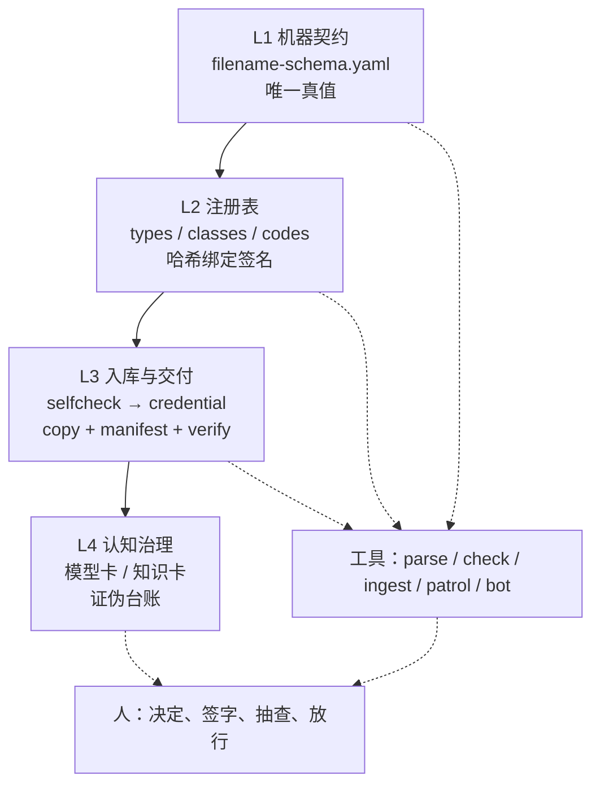

# 00 · 这套东西解决什么问题

> 一句话：**让 AI4S 研发团队的数据与结论：agent 能操作、审计可复现、变更可控。**
> agent 负责跑，程序负责判，人只做决定。
>
> 面向 5–50 人的 AI4S / 研发团队：有仪器、有湿实验、有仿真、有 AI agent，
> 数据量在百万文件量级，但没有专职数据工程团队。

## 1. 四个反复出现的失败

一个实验室通常在同一个季度里同时踩这四个坑。它们看起来无关，其实是同一个问题的四个面：
**“事实”没有唯一、可机器检查的载体。**

| # | 失败 | 典型症状 | 后果 |
|---|---|---|---|
| 1 | 文件只有人看得懂 | `final_v2_真的最终版.xlsx`、`R37-W2-3.csv`、条件全在目录名里 | 百万文件无法检索；AI 每读一个文件都要打开猜 |
| 2 | 注册表会撒谎 | 条目写着 `APPROVED`，但没人签过；AI 把 `approved_by` 填成“合伙人” | 用未批准的码命名，事后无法追溯；签字失效 |
| 3 | 算出来的和测出来的混在一起 | 一个拟合结果和仪器原始数据放在同一个文件夹、同一套命名 | 几个月后没人分得清哪个数字是测的；未复核的 AI 拟合被写进报告 |
| 4 | 死结论会复活 | 某个结论已被证伪，但旧 PPT、旧 SPEC、旧 handoff 里还在引用 | 下一个项目把它当既有事实继承，重复烧钱 |

## 2. 为什么现在需要它：操作者变了

传统治理假设有一个耐心的人：读 SOP、填元数据、记得 unsign。agent 不会。它快、字面、自信，工具留什么口子它就钻什么——包括为了消掉一个 WARN 编一个数、为了“统一格式”改内容、为了“应该能过”跳过自查。

所以这套东西的每条规则都要能落在**工具边界**上：

- 名字对不对，解析器判；
- 码能不能用，签名哈希判；
- 交付能不能收，凭据和退出码判；
- 结论能不能引用，台账判；
- 不可逆动作（签字、放行、删除、发消息）只有人能做。

它是为 agent 成为主要操作者而重新设计的治理，不是给 agent 用的工具。

## 3. 五条原则

1. **机器不打开文件就能识别。** 身份、类型、条件、时序全部在文件名里；扩展名之外全大写。
2. **人一眼看懂。** 四个区各回答一个问题：谁 / 什么 / 什么条件 / 何时第几轮。
3. **先注册后使用。** 名字里只允许出现注册且已签字的码；签的是内容，不是一个可以手改的标签。
4. **测出来的和算出来的分开。** 原始数据进 `data/`，计算产物进 `derived/`；后者必须带来源链和实名复核。
5. **只增不改。** 库内文件名冻结；变更 = 库外改好、同 T、RUN+1、整份重入；作废 = 留件 + 台账，不删除。

## 4. 四层结构

- **L1** 只写规则，不写故事。文档是人类解释，YAML 是机器真值；冲突时 YAML 赢。
- **L2** 解决“码是什么意思、谁批准过”。批准是事件，不是字段。
- **L3** 解决“东西怎么进来、进来后怎么证明没被动过”。
- **L4** 解决“结论凭什么可信、被推翻后怎么让全世界知道”。

## 5. 小团队的最小配置

| 角色 | 人数 | 职责 |
|---|---|---|
| 数据 owner | 2–20 | 产出数据、提名词条、跑自查、答 WARN |
| 收库人 / Steward | **1** | 签字、收库、抽查、放行、维护真值链 |
| 评审人 | 1–2 | 衍生数据 `reviewed_by`、模型/知识卡终审 |
| AI agent | 每人 1 个 | 跑工具、产清单、改自己获授权的 yaml；不做决定 |

> 一个人可以戴两顶帽子（owner + steward），但**两套规矩不能混**：以 owner 身份提的码，
> 也要走 REGISTRY 通道，不能自己给自己开后门。见 [04-roles-and-ai.md](04-roles-and-ai.md)。

## 6. 这套东西不是什么

| 你的痛点是… | 这套东西 | 应该用什么 |
|---|---|---|
| agent 不打开文件就读不懂、找不到 | ✅ 四区契约 | — |
| 注册表会撒谎，说不清谁批过 | ✅ 哈希绑定签名 | — |
| 这个数是测的还是算的，没人说得清 | ✅ `data/` vs `derived/` + sidecar | — |
| 被推翻的结论还在旧文档里复活 | ✅ 作废台账 + residue | — |
| 要数据目录 / 血缘 / PII 合规平台 | ❌ | DataHub、Collibra、OpenMetadata |
| 要给大模型做 RAG / 向量库 / 记忆层 | ❌ | 检索层；这套是它下面的信任层 |
| 要 LIMS / ELN / 流程 BPM | ❌ | 与它们集成，不替代 |
| 要一个不需要语义决策的即装即用产品 | ❌ | 这是 kit，不是 SaaS |

### 不适合谁

- **没有稳定物理对象编号的团队。** 如果“哪个样品”本身都说不清，先解决编号，再谈命名。
- **纯一次性脚本、没有复用预期的数据。** 治理成本会大于收益。
- **想用 AI 全自动跑完的团队。** 这套系统的核心是“决定在人、操作在 AI”；
  去掉人，剩下的只是更复杂的自动化，不是治理。
- **需要强事务、多写入者的生产数据库场景。** 这里是文件库 + 清单，不是 OLTP。
- **没有人愿意当 Steward 的团队。** 签字、抽查、放行必须有一个唯一责任人；没有就先别开始。

## 7. 这套东西的实测规模（脱敏）

- 一次规范设计前的词汇扫描：**1,751,067 个文件**，其中 1,159,750 个数据类、17,909 个仪器原始采集。
- 注册表：39 个类型码（7 个 derived）、若干 class/code。
- 单源库：某时点 **1,592 个数据文件 + 135 个 sidecar**。
- 证伪台账：**117 条**已作废/更正结论；一次对抗复核 12 条初稿 **11 条被推翻**（27 个 agent、约 256 万 token、343 次工具调用）。
- 一次“AI 整理过”的交付：**145 个文件名语法错、192 个未注册码、1 份 YAML 解析失败**——
  这是“AI 自评不可证伪、程序退出码可证伪”那条铁律的来源。

细节见 [09-case-study.md](09-case-study.md)。

这套东西也不是一次设计出来的。它被五个人用了四个月，改了十五次；哪些改动是事故推出来的、代价是什么、什么没解决，见 [13-evolution.md](13-evolution.md)。人是怎么开始用的、前 30 分钟卡在哪，见 [14-adoption.md](14-adoption.md)。让 agent 干活不烧钱、不反复错的方法，见 [15-agent-ops.md](15-agent-ops.md)。

## 8. 从这里开始

- 只想打印一页：看 [cheatsheet.md](cheatsheet.md)。
- 只想先看懂：读 [01-naming.md](01-naming.md) 与 [03-intake.md](03-intake.md)。
- 想跑起来：`pip install -e . && python examples/build_demo.py`，再按 [README](../README.zh-CN.md) 的 Quickstart。
- 想说服同事：读 [04-roles-and-ai.md](04-roles-and-ai.md) 的“AI 边界”和 [10-decisions.md](10-decisions.md) 的“被否方案”。
- 想知道它是怎么长出来的：读 [13-evolution.md](13-evolution.md)；想知道人多久开始用：读 [14-adoption.md](14-adoption.md)。
- 想知道怎么让 agent 少烧钱、少返工：读 [15-agent-ops.md](15-agent-ops.md)。
- 想直接发文章/做分享：用 [field-notes/](field-notes/README.md) 里的四篇底稿；发布前过 [16-writing.md](16-writing.md)。
- 想对外发布自己的版本：照 [12-publishing.md](12-publishing.md) 的清单逐项过。
