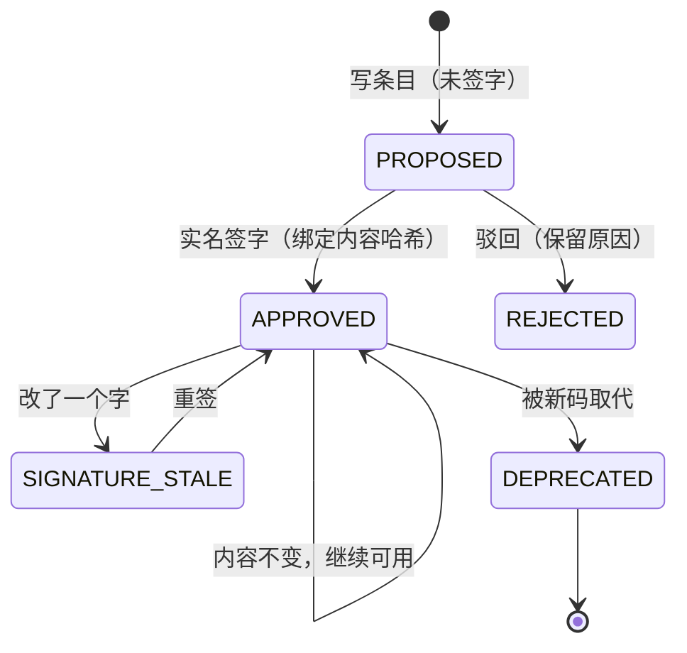

# 02 · 注册表与签字

> 目的只有一个：**名字里的每一个码，都能回答“它是什么意思、谁批准过、内容有没有被改过”。**

## 1. 四张表

| 表 | 回答什么 | 条目 | 进文件名？ |
|---|---|---|---|
| `types.yaml` | 这是什么文件 | 类型码 `MEAS` | 第 2 区 |
| `classes.yaml` | 条件属于哪一类 | class `BUF` | 否 |
| `codes.yaml` | 这一类下的哪个编号 | code `BUF1` | 第 3 区 |
| `classification.yaml` | 这一类文件多敏感 | `FLOW: secret` | 否（只影响入库） |

外加一张**只追加**的 `signatures.yaml`：签字事件，不在条目里。

### 类型码条目

```yaml
types:
  MEAS:
    name_cn: 测量数据
    description: 仪器直接产出的一次采集
    derived: false          # true=算出来的，进 derived/；false=测出来的，进 data/
    proposer: Li Ming       # 提案人实名
    proposed_at: 2026-03-04
    status: PROPOSED        # PROPOSED / DEPRECATED / REJECTED
```

`derived` **必填且必须是布尔值**（写成 `"true"` 字符串会被判错，分流会全反）。

### class 条目

```yaml
classes:
  BUF:
    name_cn: 缓冲液
    owner: Li Ming
    scope: 缓冲液配方、浓度、pH
    description: 湿实验的缓冲液条件
    proposer: Li Ming
    proposed_at: 2026-03-04
    status: PROPOSED
```

### code 条目

```yaml
codes:
  BUF1:
    class: BUF
    instance: >
      10 mM Tris-HCl, pH 8.0, 1 M KCl；配制后 0.22 µm 过滤；
      完整配方见 R0000_ALL_ALL__PARAM__BUF1__T202603041000_RUN0000.yaml
    proposer: Li Ming
    proposed_at: 2026-03-04
    status: PROPOSED
```

`instance` 是整套体系的地基：**同 code 必须同参数集**。两个 code 的 instance 逐字相同
会被判 `DUPLICATE_INSTANCE`——这两个条目其实是同一个码。

## 2. 生命周期



三条铁律：

1. **先注册后使用。** `PROPOSED` 的码不能出现在归档文件名里，不得先用后补。
2. **码一经使用，含义冻结。** 要改配方/参数 → 注册新号（`DK1 → DK2`），旧号 `DEPRECATED`
   + `superseded_by`。旧号已用进库内文件名的，那些文件全部失效，按“改名重入”处理。
3. **签字是实名 + 日期，用工具，不手填。** 称谓（合伙人/负责人/老板/领导/本人/AI）
   一律判为没签。

## 3. 公开版的硬化：签名绑定内容哈希

### 内部版怎么做

条目里直接写：

```yaml
status: APPROVED
approved_by: 合伙人      # ← 事故来源
approved_at: 2026-08-03
```

问题：`APPROVED` 只是一个字符串。改了内容它还在；AI 可以把它填成“合伙人”；
没有任何机制能证明“批准的是哪一版内容”。真实团队为此撤销过一整批 162 条签字。

### 公开版怎么做

```yaml
# signatures.yaml（只追加）
signatures:
  - kind: type
    name: MEAS
    content_sha256: 9f2c…   # 条目规范化 JSON 的 sha256
    approved_by: Li Ming
    approved_at: 2026-03-04
```

- 条目本身只写 `PROPOSED` / `DEPRECATED` / `REJECTED`，**不写 APPROVED**。
- 有效状态 = 最新一条未撤销签名 + 哈希对得上。
- 改一个字符 → 哈希变 → 签名自动失效（`SIGNATURE_STALE`），必须重签。
- 撤销也是一条事件（`revoked: true`），不删除历史。

这把“记得去 unsign”变成了**机器不变量**。代价是签名文件与条目分开，读的时候要 join；
但小团队的条目数量（几十到几百）完全承受得起。

### 签名命令

```bash
# 预览（不写文件）
ai4s registry sign --registry registry --kind type --name MEAS \
  --who "Li Ming" --date 2026-03-04

# 真签
ai4s registry sign --registry registry --kind type --name MEAS \
  --who "Li Ming" --date 2026-03-04 --apply

# 一次签多个
ai4s registry sign --registry registry --kind code \
  --name BUF1 --name DAQ1 --name COND1 \
  --who "Li Ming" --date 2026-03-04 --apply

# 撤销
ai4s registry revoke --registry registry --kind type --name MEAS \
  --who "Li Ming" --date 2026-03-05 --reason "码义写错，重开" --apply
```

> **谁能签？** 一个团队最好只有一个人（Steward）。不是因为他更聪明，
> 而是因为“谁批准”必须有唯一责任人。签字键不交给 AI，也不交给“大家”。

## 4. 三种变更，三条路

| 要改什么 | 走哪条 | 结果 |
|---|---|---|
| 新增码 | 《新词条提案》→ 签字 | 新增一条，旧的无影响 |
| 改**记录性字段**（笔误、补 notes、补出处） | 《对既有码的修订》→ 重签 | 含义不变，签名换新 |
| 改**判别性参数/含义**（配方变了） | **注册新号**，旧号作废 | `DK1 → DK2`，旧号 `DEPRECATED`，用过旧号的文件全部失效 |

判断“判别性”的一个好用的问题：

> 库里已经用这个码命名的文件，按新写法读，**当时的条件会不会被改写**？
> 答“这套参数从当初那批起就一直这么跑、只是没记” → 补记录；
> 答“后来改成这样的” → 改配方，注册新号。

### 别人的码怎么改

- 只能为 `proposer=本人` 的码填《修订单》。
- 要改别人建的码，填《更改请求》，命名 `请求-<发起人>-致-<码主>-YYYYMMDD.md`；
  码主认可后由**码主**走修订/新号。
- 越权修订单会被巡检点名；这是为了防“AI 替码主答应”。

## 5. 真值链：一份表，五个落点

注册表最危险的是**长得像真值的旧副本**，旧本身倒还好。公开版的建议：

```
① 主仓 registry/            唯一编辑位
   ↓ 签字 + verify 全绿（同一次操作完成）
② 权威位（共享盘/对象存储）  全网最准的一份；只能从 ① 同步，不许手改
   ↓ 自动/符号链接
③ 收库机 snapshot/          收库工具只读这一份
   ↓ 发版
④ 发布包（zip + sha256）
   ↓ 分发
⑤ 各人本地包                允许滞后，不允许反向修改
```

规则：

- **①→② 是手动但强制的一步**：签完字不同步权威位 = 事没办完。
- **②③ 永远同龄**；④⑤ 允许滞后，那是发版节奏，不是失同步。
- 编辑位在工作中允许短暂领先；签字完成后当天必须收敛到 ②。
- 每次发版前跑一次“五张表 × 五个落点”的哈希巡检；`must` 层不一致先修链，再收库。

公开版工具用 `registry_snapshot`（注册表 + 签名的指纹）写进每份验收凭据；
收库人只要比对凭据上的 fingerprint 与权威位是否一致，就知道“这批是用哪版字典跑的”。

## 6. 常见错误 → 动作

| 现象 | 意思 | 动作 |
|---|---|---|
| `TYPE_UNKNOWN` | 码没注册 | 停下来提名词条；**不要**先改名 |
| `TYPE_NOT_APPROVED` | 注册了但没签 | 等签字；不是交付人的错 |
| `SIGNATURE_STALE` | 签完又改了内容 | 重签；不要绕过 |
| `TYPE_DEPRECATED` | 码已作废 | 按 `superseded_by` 换号；没有接替号就问 Steward，**不要自己挑一个** |
| `DUPLICATE_INSTANCE` | 两个码参数完全相同 | 合并成一个；不是“再开一个” |
| `CLASS_MISSING` | code 指向不存在的 class | 先建 class，再建 code |
| `SIGNATURE_UNKNOWN` | 签名指向已删除的条目 | 恢复条目或撤销签名，二选一 |

## 7. 检查清单

- [ ] 每个类型码都有 `derived`，且是布尔值。
- [ ] 每个 code 的 `instance` 能独立区分任意两个 code。
- [ ] 没有 `status: APPROVED` 残留在条目里（公开版以签名为准）。
- [ ] 每个已用码都有有效签名；`ai4s registry verify` 全绿。
- [ ] 作废条目都有 `superseded_by` 或 `deprecated_reason`。
- [ ] 发版前五个落点哈希一致。
