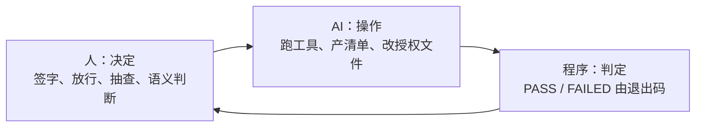

# 04 · 角色、AI 边界与红线

> 这套系统里最贵的一条设计是**分工**，比命名和工具都贵：
> **决定在人，操作在 AI；判定在程序，不在任何人的自信里。**

## 1. 四个角色

| 角色 | 是谁 | 能碰什么 | 绝不碰什么 |
|---|---|---|---|
| **数据 owner** | 2–20 人 | 自己目录里的文件；拍板改名与不入库 | 库（连读都不必）；别人的码 |
| **owner 的 AI** | 每人一个 agent | 跑自查、产改名清单、改本人获授权的 yaml | 移动/删除/新建文件夹；签字栏；入库 `--apply` |
| **Steward（收库人）** | **1 人** | 改总表、签字（本人亲跑）、收库、抽查、放行 | 代改别人的文件（只放行或打回） |
| **评审人** | 1–2 人 | 衍生数据 `reviewed_by`、模型/知识卡终审 | 替 owner 答 WARN |

### 双帽纪律

同一个人可以既是 owner 又是 Steward，但**两套规矩不能混**：

| 帽子 | 身份 | 遵守什么 |
|---|---|---|
| Owner | 与其他 owner 完全同权 | 提案走 `REGISTRY/`、自查 PASS 出凭据、等回执 |
| Steward | 唯一签字/收库人 | 改总表、签字、收库八步、按真值链发布 |

以 owner 身份提的码，也要走 REGISTRY 通道，不能自己给自己开后门。
“我戴 owner 帽的时候没遵守自己发的规矩”是真实发生过的，也是双帽纪律写进文档的原因。

## 2. 决定 / 操作 / 判定，三层分开



- **人**对“值对不对、内容对不对得上名字、这批该不该收”负责。
- **AI** 对“有没有真的跑、清单全不全、格式对不对”负责。
- **程序**对“PASS 不 PASS”负责。

三者不能互相替代。尤其是最后一条：**AI 的自我评估不可证伪，程序的退出码可证伪。**

## 3. 十二 条红线

下面这些动作，AI 永远不自动做；人做也要留痕。

| # | 动作 | 谁 | 为什么 |
|---|---|---|---|
| 1 | 字典签字 / 撤销 / 重签 | Steward 本人 | 曾因 AI 代签整批撤销 162 条 |
| 2 | 衍生 sidecar 的 `reviewed_by` / `reviewed_at` | owner 本人 | 复核是“我看过并认账”，不能代 |
| 3 | 库文件去只读 | 只有 Steward，且台账记“谁、何时、为什么、动了哪个文件” | 事后追责的唯一线索 |
| 4 | `ingest copy --apply` | Steward；AI 只允许空跑 | 二级审查的实质是人做 |
| 5 | 人工抽查 | Steward 打开文件看 | 同上，不可代跑 |
| 6 | 改名 `--apply` | AI 可执行，但必须先预演 + 本人明确点头 | 动的是真实数据，且原名留档不可逆 |
| 7 | 让文件“对系统消失”（exclude） | 本人拍板后 AI 才可执行 | 唯一让文件消失的操作 |
| 8 | “某原始数据不入库”的决定 | owner 本人，且写进台账 | 不可复得的实测数据不能被 AI 判成“大概不重要” |
| 9 | 注册新码 / 改已注册码的含义 | 只有 Steward 动总表 | 防止“静默改写” |
| 10 | 删除、移动任何数据文件或文件夹 | 任何人都不自动做；AI 完全禁止 | 全案唯一的兜底是“原件从未被动过” |
| 11 | 批次台账的“放行人”栏 | Steward 本人填 | 责任归属的书面痕迹 |
| 12 | 向他人发送消息 / 投放交付物 | 本人做 | AI 不代发 |

> 第 4、5 条在“每天自动收库”的团队里可以放宽为“规则放行”：由机器按
> “凭据 PASS + 清单一致 + 快照对得上 + 无任何旗”自动放行。但**带旗的批次**
> 仍然回到人；而且“规则放行”本身是人签过字的规则，不是 AI 的判断。

## 4. AI 可以做什么、不可以做什么

### 可以

- 跑 `ai4s check`、读报告、把问题分类。
- 产 `改名清单.csv`，用 `ai4s rename` 预演，等本人点头后 `--apply`。
- 改本人明确授权的三件套 yaml（`status` 永远 `PROPOSED`，签字栏永远留空）。
- 把 WARN 逐条念给本人听，把本人的原话填进 `answer` 列。
- 把交付物复制到本人共享目录（**只复制**，不删不搬），两端对哈希。
- 读公开文档、查注册表、解释错误码。
- 起草给人看的文字；发布前必须过 [16-writing.md](16-writing.md) 的 humanizer 清单，并由人确认。

### 不可以

- ❌ 修改 `selfcheck.py` / schema / snapshot 来让检查通过——**那叫把尺子掰弯，不叫修好**。
- ❌ 在没跑过的情况下说“应该能过了”。
- ❌ 把模型原文直接当 README、文章或发布说明发出去。
- ❌ 把 `reviewed_by` 填成“本人”“领导”“AI”。
- ❌ 替 owner 回答 WARN。
- ❌ 运行 `ingest copy --apply`。
- ❌ 新建/重命名/移动/删除任何文件夹。
- ❌ 打开、读取、摘录机密类型文件的内容。
- ❌ 为了让某条告警消失而给文件加 `_` 前缀。

### 一条判断标准

> 如果这个动作**错了还能改回去**，AI 可以做（改名、生成清单、复制）；
> 如果**错了不可逆**（签字、删除、加密、覆盖、发布），只有人能做。

## 5. PASS 由程序判定

`ai4s check` 的退出码：

| 退出码 | 含义 |
|---|---|
| `0` | `ERROR = 0`，生成 `_credential.txt` |
| `1` | 还有 `ERROR` 要改 |
| `2` | 环境问题（缺 Python/PyYAML/registry） |
| `3` | `--strict` 下还有未答复的 WARN |

规则：

- 通过与否，**以程序输出为准**，不以 AI 的判断为准。
- 但这句话只管 PASS/FAILED 这一件事。**PASS 是“没踩到已知的坑”，不是“这批东西是对的”。**
  程序只查它被写了要查的那些；规范上该不该这么改、这个数合不合物理、
  两个码的字段名要不要统一，它一个字都不会说。

## 6. WARN 的动词是“答”，不是“改”

PASS 只说明 `ERROR = 0`。WARN 是**还没有人回答的问题**，它们会原样写进凭据，
收库人一条条问。**PASS 之后活还有一半。**

九类 WARN 里只有“元数据泄漏”一类是能“改”的（清掉表格里的本机路径和作者名），
其余八类的所谓“改”，全都是编数据：

| WARN | 如果你去“改”它，你实际在做的事 |
|---|---|
| RUN 断号 | 伪造一个 RUN0000，或把现有文件改号顶上 = **伪造采集轮次** |
| 空目录 | 删目录 = 删掉可能只是漏传的数据位置 |
| 无可交叉验证的编号 | 往文件里塞一个编号 = **伪造内外一致** |
| 时间戳大簇 | 编一个“看起来合理”的采集时间 |
| 覆盖缺口 / 无文字层 | 没看图就宣称“确认过了” |
| 编号孤例不符 | 改文件名去迁就那一处，或改报告 = **伪造第三方报告** |

正确问法看 `_pending.csv` 的 `who` 列：

- `ai-fixable-with-approval` → 问“**要不要我清掉**”。
- `owner-only` → 问“**这是丢了 / 传漏了 / 有意不交？**”。

**WARN 的出口是台账，不是改文件。**

### 一个真实事故的泛化

某次交付里，文件名是错的，内容里的编号反而是对的——那是唯一能破案的线索。
如果 AI 为了“消错”把内容改成和错误文件名一致，就是把错误从“可见”变成“不可见”，
比不改危害大得多。

规则：**“内容编号与文件名不一致”时，先问本人哪边是对的，他拍板前一个字不许改。**

## 7. 为什么不能信“AI 整理过了”

真实案例：三位同事都用 AI 整理过交付物，结果仍然交上来：

- **145 个文件名语法错**
- **192 个用了没注册的码**
- **1 份 YAML 因为冒号后少一个空格，整个解析不了**

AI 不是不努力。问题是**自我评估不可证伪**。所以：

- 报告问题必须以“我跑了一遍，结果是 X”开头。
- 不许说“应该可以通过了”。
- 不许因为改完了就宣布合格。

这条规则反过来也保护 AI：它不需要为“科学对不对”背锅，只需要为“有没有真的跑”负责。

## 8. 给 AI 的指令块（可直接改）

```text
你的工作目录是 <lab>。先读 AGENTS.md。
这次要交付的根是：<SR_DATA 路径>

你只准做这三件事：
1) 跑 `ai4s check <根> --registry <registry> --library <library>`，读 `_selfcheck_report.txt`；
2) 产 `改名清单.csv`，用 `ai4s rename` 先预演，给我看，我点头你再 --apply；
3) 改我明确让你改的 yaml。

绝对不许：
- 新建、重命名、移动、删除任何文件夹；
- 运行 `ai4s ingest copy --apply`；
- 改 selfcheck / schema / registry 里的任何东西来让检查通过；
- 填 reviewed_by / 签字栏；
- 替回答 WARN；
- 读机密类型文件的内容。

拿不准就停下来问，一次问一两个具体问题。
判定 PASS 的是程序，不是你的判断。
```

## 9. 抽查与复核：证据，不是自信

- 抽查要写“看了哪个文件、页上原话是什么、和文件名对不对得上”。
  “已核对，一致”不算证据。
- 复核衍生数据，要能指出 `derived_from`、`input_sha256` 和一处可复算的数字。
- 模型/知识卡的置信等级，宁可低估，不可高估。
  真实项目在两个月里**自我推翻 7 次**，其中 5 次是“一个看起来合理的数被下游当成了实测”。

## 10. 什么时候该停下来

- 同一个问题解释三次还错 → 先改流程/工具的措辞，别怪人。
- 同一类失败一周内复发 → 加一条机器检查，不要靠提醒。
- 一个人同时是 owner + Steward + 评审人 → 至少把签字和抽查分开；
  否则“双帽”会变成“一顶帽子说了算”。
- 单日入库 > 1000 文件或出现第二个收库人 → 重新设计权限模型，不要硬撑。
