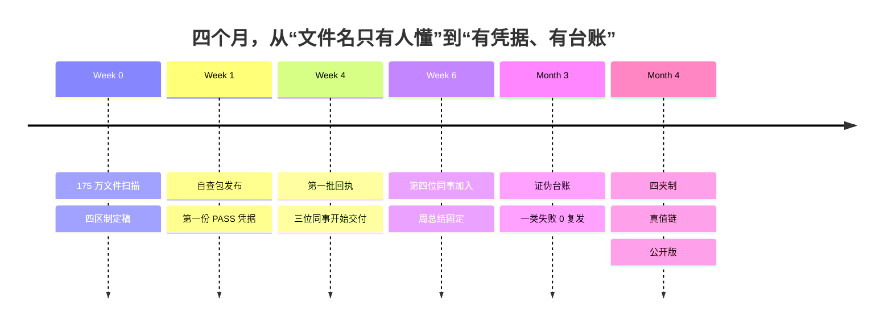

# 13 · 架构是怎么一步步修出来的

> 大多数治理仓库只给你最终形态。这一篇给的是中间那些“当时不得不改”的时刻。
> 没有真实日期和人名，用“第 0/1/4/6 周”表示顺序；数字来自当时的交付、复盘和周总结。

## 0. 为什么把“修理过程”也放出来

- 最终架构看起来像设计出来的，其实是事故推出来的。
- 你没法直接跳到最终形态；顺序错了会卡住。
- 每个改动都有代价。不写代价，别人会以为免费。
- “什么没解决”比“什么解决了”更有用。

这套东西不是一次设计出来的。它是五个人在用，边用边改，改了四个月。

## 1. 一条时间线



## 2. 十五次改动（按“什么坏了”排序）

| # | 触发 | 改了什么 | 代价 | 换来了什么 | 没解决 |
|---|---|---|---|---|---|
| 1 | 同一种数据有五种命名方言 | 先扫 175 万文件，再写规范 | 两周只做扫描，不出规范 | 知道“条件在哪”，不拍脑袋 | 扫描本身不解决历史文件 |
| 2 | 类型和条件混在一区 | 三区改四区（身份/类型/条件/时序） | schema 升版、老文档改口 | 类型和条件可以独立校验 | 名字变长 |
| 3 | 一个 RUN 只对应一个文件，P 永远是 P0000 | 取消 P 槽位，第 4 区只留 T+RUN | 旧文档、旧脚本改口 | 少一个永远为 0 的字段 | 设备原始分段号只能进日志 |
| 4 | 整片、整批、库级写法混乱 | `ALL` 只在 W/D；`R0000_ALL_ALL` 专用于库级 | 规则更多 | 汇总件有唯一写法 | `ALL` 不能部分选取 |
| 5 | 11 个条目写了 `APPROVED`，没人签过 | 实名签字 + 称谓黑名单 | 签字变成一个人的动作 | “谁批的”第一次可追 | 签字仍是人工步骤 |
| 6 | AI 代签，整批 162 条签字被撤销 | 签字键只归本人；双帽纪律 | 一次全量重签 | 签字是人的决定 | 没有机器能阻止人把钥匙交出去 |
| 7 | 新建“交付_日期”中转夹，三次都失败 | 声明根 + `_交付清单.csv`，不设中转区 | 收库人要学会看清单 | 交付可复核 | 清单本身仍可能漏 |
| 8 | 跨网络复制 3000 个文件时崩溃，已落盘文件没有清单行 | 每落一个文件立刻写一行 + fsync | 复制变慢 | 清单和磁盘对得上 | 崩溃后仍需人工核对 |
| 9 | 拟合结果和原始数据混放 | `data/` 与 `derived/` 分区；sidecar；四道闸门 | 衍生数据多一道手续 | 测的/算的分得清 | 人工复核仍是瓶颈 |
| 10 | 有人想“顺手改一下”库里的文件 | 库内永不原地改：T 不变、RUN+1、整份重入 | 库里会有多个版本 | 旧引用不悬空 | 要靠台账回答“现行版是哪个” |
| 11 | worktree 里有一份路径酷似主仓的 `dict/` | 五落点哈希巡检；真值链 | 每次发版多一步 | “哪份最准”有答案 | 仍靠人执行巡检 |
| 12 | 三位同事都用 AI 整理过，仍交来 145 个语法错、192 个未注册码 | PASS 由程序判定；AI 只负责跑 | 要维护检查器 | 自评变成退出码 | PASS 不等于科学正确 |
| 13 | 手拼回执卡没有底稿，同事照卡回复被机器拒收 | 卡只由工具发；一个题号一个选项 | 多写一个发卡工具 | 回复能被机器认 | 复杂沟通仍要人 |
| 14 | 周总结变成流水账，上周待办没人回看 | 固定第 6 节“上周说要做的，做了没” | 每周多 30 分钟 | “之后 0 例”有证据 | 仍靠人写 |
| 15 | 被推翻的结论继续活在旧 PPT 里 | 证伪台账 + `residue` 清扫 | 一次对抗复核成本很高 | 死结论有地方待 | 旧文件不会自己消失 |

## 3. 三个“如果重来”的顺序

1. **先扫描，再规范。**
   真实情况是：扫完 175 万文件才发现，有人的条件全在目录名里，文件名 87% 是纯序号。
   如果先写规范，会设计出一套根本落不了地的字段。

2. **先跑通一批 10–50 个文件，再上自动化。**
   第一个闭环要包含：一个真实文件、一次自查、一份凭据、一次入库、一次 verify、一张回执。
   跑通之前，不要碰加密、机器人、看板。

3. **先定“谁能决定”，再定工具。**
   签字、放行、抽查、`reviewed_by` 只能归人。工具可以先粗糙，决定权不能先模糊。

## 4. 每个改动必须写五个字段

```yaml
trigger:     什么坏了（具体到一次事故/一个数字）
change:      改了什么（一句话）
cost:        付出了什么（时间、复杂度、人的耐心）
effect:      换来了什么（可观察，不写“提升了效率”）
unresolved:  还有什么没解决
```

模板：[templates/evolution-entry.md](../templates/evolution-entry.md)。

写不出 `cost` 的，多半只是愿望。

## 5. 哪些没解决

- **单点 Steward。** 一个人签字、收库、抽查、放行，没有 plan B。
- **库是普通目录。** 只读是权限层，不是事务层；没有机制强制“只能通过工具写入”，`verify` 只能事后发现。
- **备份没完全落地。** 开卷快照 + 异机副本的保留策略需要单独拍板。
- **manifest 的规模。** 几十万行以后要换 sqlite。
- **模型没到 L3。** 15 个模型最高 L2，没有和自己的实测数据标定。
- **加密只覆盖增量。** 已经发出去的存量收不回；文件名本身不加密。

## 6. 怎么用这篇

- 不要照抄最终架构，**照抄顺序**。
- 找到你的“第一次事故”，从那里开始，而不是从“完整规范”开始。
- 每个改动写代价；否则团队会以为治理是免费的。
- 每季度回看一次：哪些改动可以删，哪些代价已经大于收益。

---

> 想直接发文章：用 [field-notes/01-the-changelog-is-the-product.md](field-notes/01-the-changelog-is-the-product.md)。
> 想先看自己的目录有多乱：`ai4s audit <目录>`，只读，不改文件。
